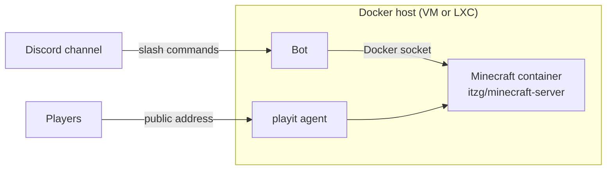

# mc-discord-bot

[](https://github.com/jonesthala/mc-discord-bot/actions/workflows/tests.yml)

Start Minecraft servers from Discord, only when someone actually wants to play.

Friends type `/mc start` in a Discord channel. The bot boots a Paper or Vanilla server in
Docker, posts the address as soon as people can join, and shuts the server down again after
15 minutes without players, with a backup of the world. It is made for small home servers
(mine is an old laptop with 8 GB of RAM) where a Minecraft server shouldn't run around the clock.

```text
/mc start survival
⏳ survival (Paper 26.3) startet, das dauert 1–3 Minuten. Ich schreibe hier, sobald ihr joinen könnt.
✅ survival (Paper 26.3) ist bereit, ihr könnt joinen! Adresse: example.joinmc.link · zu Hause: 192.168.1.50
💤 survival hat sich selbst gestoppt, weil 15 Minuten niemand online war.
💾 Backup von survival gespeichert.
```

> The bot's messages are in German. English translations are very welcome, see [Contributing](#contributing).

## Features

- **On demand.** One server runs at a time and stops itself when nobody has been online for a while.
- **Paper or Vanilla, any release.** `/mc create` suggests versions live from PaperMC and Mojang.
  The version is pinned, so a world is never upgraded by surprise.
- **Whitelist and online mode, always on.** One shared whitelist; changes apply live.
- **Backups** after every stop (the newest few are kept) and on demand while running.
- **Simple roles.** Everyone in the channel can start, stop and check the status. Admins (a
  Discord role or user IDs) create and delete servers, edit the whitelist, read logs and use the console.
- **Stop protection.** While people are online, only admins can stop the server.
- **Talks back.** Posts when a server is ready, stopped itself or crashed; the bot's status
  shows who is online.
- **Works behind CGNAT** through a free [playit.gg](https://playit.gg) tunnel, or with plain port forwarding.
- **Fenced in.** Game servers can reach the internet but not your home network.

## How it works



- Every server is a container of [`itzg/minecraft-server`](https://github.com/itzg/docker-minecraft-server).
  Its world lives in a folder on the host, so the container is recreated with fresh settings on every start.
- The bot follows Docker events to announce "ready", "stopped itself" and "crashed", and makes a backup after every stop.
- The itzg image's autostop feature shuts a server down when it has been empty for `MC_AUTOSTOP_MINUTES`.

## Requirements

- A Linux machine with **Docker** and **Docker Compose v2**, ideally a dedicated VM or LXC (see [Security](#security))
- About **3 GB of free RAM** while a server runs (2.5 GB Java heap plus overhead; adjustable)
- A Discord server where you may add a bot
- Optional: a free [playit.gg](https://playit.gg) account, if you can't forward a port

## Installation

### 1. Create the Discord bot

1. Open the [Discord Developer Portal](https://discord.com/developers/applications) → **New Application**.
2. **Bot** → **Reset Token** → copy the token. Keep it secret.
3. **OAuth2 → URL Generator**: scopes `bot` and `applications.commands`; bot permissions
   **View Channels**, **Send Messages**, **Embed Links**. Open the generated link and add the bot to your server.
   No privileged intents are needed.
4. In Discord, create a channel for the bot (e.g. `#minecraft`) and an admin role (e.g. `MC Admin`).
5. User Settings → Advanced → turn on **Developer Mode**. Right-click → **Copy ID** for the server,
   the channel and the role.

### 2. Get the code

```bash
sudo git clone https://github.com/jonesthala/mc-discord-bot /opt/mcbot
cd /opt/mcbot
sudo cp .env.example .env && sudo cp playit.env.example playit.env
sudo chmod 600 .env playit.env
sudo mkdir -p /srv/minecraft
```

### 3. Configure

Edit `.env` and fill in `DISCORD_TOKEN`, `DISCORD_GUILD_ID`, `DISCORD_CHANNEL_ID` and
`DISCORD_ADMIN_ROLE_ID` (or `DISCORD_ADMIN_USER_IDS`). Read the
[Minecraft EULA](https://aka.ms/MinecraftEULA); set `MC_EULA=TRUE` only if you accept it.
All settings are listed under [Configuration](#configuration).

### 4. Decide how players connect

| Option | When | What to do |
| --- | --- | --- |
| **playit.gg tunnel** | Behind CGNAT, or you don't want to open ports | On playit.gg: **Agents → Add Agent → Docker**, put the secret key into `playit.env` as `SECRET_KEY=`. After the first start: **Tunnels → Add Tunnel → Minecraft Java**, agent = yours, local address `127.0.0.1`, port `25565`. Put the tunnel address into `MC_PUBLIC_ADDRESS`. |
| **Port forwarding** | You control your router | Forward TCP `25565` to this machine, delete the `playit` service from `docker-compose.yml`, set `MC_PUBLIC_ADDRESS` to your domain or IP. |
| **LAN only** | Only people at home play | Delete the `playit` service, set `MC_LAN_ADDRESS` to this machine's IP. |

### 5. Recommended: Docker settings and LAN isolation

```bash
# Gives servers 90 s to save the world on stop, and caps Docker's log size.
# Merge by hand if you already have an /etc/docker/daemon.json.
sudo install -m 644 deploy/daemon.json /etc/docker/daemon.json && sudo systemctl restart docker

# Keeps the game containers away from private networks (10/8, 172.16/12, 192.168/16, 100.64/10).
# The unit expects the code in /opt/mcbot; adjust the paths if you cloned it elsewhere.
sudo cp deploy/mc-isolate.service /etc/systemd/system/
sudo systemctl daemon-reload && sudo systemctl enable --now mc-isolate.service
```

### 6. Start

```bash
docker pull itzg/minecraft-server:latest   # optional, otherwise the first /mc start pulls it
docker compose up -d --build
docker compose logs -f bot                 # wait for "Logged in as ..."
```

### 7. Your first server

In your bot channel:

```text
/mc create name:survival typ:Paper version:Neueste: 26.3
/mc whitelist add player:YourMinecraftName
/mc start survival
```

The first start takes a few minutes (download and world generation). The bot posts when you can join.

### Running it in a Proxmox LXC

It runs fine in an **unprivileged** Debian 13 container with `nesting=1,keyctl=1`, for example:

```bash
pct create 103 local:vztmpl/debian-13-standard_13.6-1_amd64.tar.zst --hostname minecraft \
  --unprivileged 1 --features nesting=1,keyctl=1 --cores 3 --memory 3584 --swap 1024 \
  --rootfs local-lvm:32 --net0 name=eth0,bridge=vmbr0,ip=dhcp --onboot 1
pct start 103
pct exec 103 -- bash -c 'apt-get update && apt-get install -y docker.io docker-compose git'
```

Then follow the steps above inside the container (`pct enter 103`).

## Commands

| Command | Who | What it does |
| --- | --- | --- |
| `/mc start [name]` | everyone | Start a server (default: the one played last) |
| `/mc stop` | everyone* | Stop it, the world is saved |
| `/mc status` | everyone | State, version, players online, RAM, address |
| `/mc list` | everyone | All servers with their versions |
| `/mc whitelist show` | everyone | Who may join |
| `/mc create <name> <typ> <version>` | admins | New server; Discord suggests versions while you type |
| `/mc delete <name>` | admins | Delete with a confirm button; the folder goes to `trash/` |
| `/mc whitelist add/remove <player>` | admins | Edit the shared whitelist, applied live. `add` checks the name at playerdb.co (Mojang as fallback) and refuses names without an account |
| `/mc backup [name]` | admins | Backup now, also while running |
| `/mc logs [name]` | admins | Last lines of the server log (only you see it) |
| `/mc console <command>` | admins | Run a console command via RCON (only you see the answer) |

\* While players are online, only admins can stop the server.

The commands only work in the configured channel.

## Configuration

All settings live in `.env`.

| Variable | Default | Meaning |
| --- | --- | --- |
| `DISCORD_TOKEN` | required | Bot token |
| `DISCORD_GUILD_ID` | required | Your Discord server |
| `DISCORD_CHANNEL_ID` | required | The only channel the bot answers in |
| `DISCORD_ADMIN_ROLE_ID` | – | Members with this role are admins |
| `DISCORD_ADMIN_USER_IDS` | – | Comma-separated user IDs that are admins |
| `MC_EULA` | `FALSE` | `TRUE` once you have accepted the Minecraft EULA; no server starts without it |
| `MC_PUBLIC_ADDRESS` | – | Address shown to players (e.g. your playit.gg address) |
| `MC_LAN_ADDRESS` | – | Address shown for players at home |
| `MC_MEMORY` | `2560M` | Java heap of the game server |
| `MC_MEM_LIMIT` | `3200m` | Hard memory limit of the game container (heap + about 700 MB) |
| `MC_AUTOSTOP_MINUTES` | `15` | Stop after this many minutes without players |
| `MC_MAX_PLAYERS` | `10` | Player slots |
| `MC_BACKUP_KEEP` | `5` | Backups kept per server |
| `MC_MOTD` | `Minecraft · {name}` | Text in the server list; `{name}` becomes the server name |
| `MC_IMAGE` | `itzg/minecraft-server:latest` | Game server image |
| `MC_DATA_DIR` | `/srv/minecraft` | Data folder; set in `docker-compose.yml`, must match the volume there |
| `TZ` | `UTC` | Time zone for logs and backup names |
| `WEB_PORT` | `0` | Admin API for a web panel on this port; `0` = off (see below) |
| `WEB_TOKEN` | – | Token the panel must send; at least 32 characters, e.g. `openssl rand -hex 32` |

### Admin API (optional)

With `WEB_PORT` and `WEB_TOKEN` set, the bot also answers HTTP: the same actions as `/mc`, as JSON, for a web panel
such as the one in [seerr bot but better](https://github.com/jonesthala/seerr-bot-but-better). Every call needs
`Authorization: Bearer <WEB_TOKEN>`. Publish the port only to your home network (`ports:` in `docker-compose.yml`
or a `docker-compose.override.yml`).

| Call | What it does |
| --- | --- |
| `GET /api/status` | Running server, players, RAM, all servers with their backups, whitelist |
| `POST /api/start` `{"name"}`, `POST /api/stop` `{"force"}` | Start a server, stop the running one (`force` even with players online) |
| `POST /api/backup` `{"name"}` | World backup now |
| `GET /api/logs?name=&lines=` | Last log lines (at most 1000) |
| `POST /api/console` `{"command"}` | Console command on the running server |
| `POST /api/whitelist/add`, `/api/whitelist/remove` `{"player"}` | Whitelist |
| `GET /api/versions?type=paper&q=` | Versions to choose from |
| `POST /api/servers/create` `{"name","type","version"}`, `/api/servers/delete` `{"name"}` | Create, delete (to `trash/`) |

Starting and stopping from the panel is announced in the Minecraft channel, so players know.

## Data on disk

```text
/srv/minecraft/
├── servers/<name>/mcbot.json   type and version of the server
├── servers/<name>/data/        the server folder (world, plugins, configs)
├── backups/<name>/*.tar.gz     world backups, the newest MC_BACKUP_KEEP are kept
├── trash/<name>_<time>/        deleted servers, remove them by hand when sure
├── whitelist.txt               shared whitelist, one name per line
└── state.json                  which server was started last
```

## Updating

```bash
cd /opt/mcbot && sudo git pull && docker compose up -d --build
```

A running game server keeps running while the bot restarts.

## Security

- **The Docker socket is root on the host.** The bot needs it to start and stop containers, so
  anyone who takes over the bot controls that Docker host. Run it on a **dedicated VM or LXC**,
  never on a machine with other important things, and keep the bot token secret.
- **Game servers** always use the whitelist and online mode, have a memory limit and public
  DNS resolvers, and `mc-isolate` stops them from reaching your private networks.
- **Secrets** (`.env`, `playit.env`) are git-ignored; keep them at mode 600.
- **Deleting** a server never removes data; it moves to `trash/`.
- **The admin API** (off unless `WEB_PORT` is set) can do what MC admins can, console included. Use a long random
  `WEB_TOKEN`, keep it in `.env` only, and never publish the port to the internet.
- Found a security problem? Please open a GitHub issue without exploit details, and I'll get in touch.

## Troubleshooting

| Problem | Try this |
| --- | --- |
| Slash commands don't show up | Invite the bot with the `applications.commands` scope; check `DISCORD_GUILD_ID`; reload Discord with Ctrl+R |
| "Bitte im #… benutzen" | You're in the wrong channel; check `DISCORD_CHANNEL_ID` |
| "Das dürfen nur MC-Admins" | Give yourself the admin role, or add your user ID to `DISCORD_ADMIN_USER_IDS` |
| The server takes long to start | The first start downloads the server and generates the world. Admins: `/mc logs` |
| Players can't join | Are they on the whitelist? Does their game version match? For playit: is the tunnel's local address `127.0.0.1:25565`? |
| The server gets killed | Too little memory: lower `MC_MEMORY` or raise `MC_MEM_LIMIT` |
| No server starts, the bot names a player | That name on the whitelist has no Minecraft account (typo, or the player renamed). The server image refuses to start then. Remove it with `/mc whitelist remove <name>` |

## Development

```bash
python -m unittest discover -s tests -v
```

The tests cover everything that works without Docker or Discord: validation, version lists,
player name checks, settings, the whitelist, backups and the files on disk. They need no extra
packages and no network.

## Contributing

Issues and pull requests are welcome. Ideas that would help:

- English (or other) messages, selectable in `.env`
- More server types, such as Fabric or Forge
- A command to move a server to a newer Minecraft version

Please keep the standard-library-only parts (`bot/core.py`, `bot/versions.py`) free of new dependencies and add tests for new logic.

## License

[MIT](LICENSE). Minecraft is a trademark of Mojang Studios and Microsoft; this project is not
affiliated with them. Running a Minecraft server means accepting the
[Minecraft EULA](https://aka.ms/MinecraftEULA).
